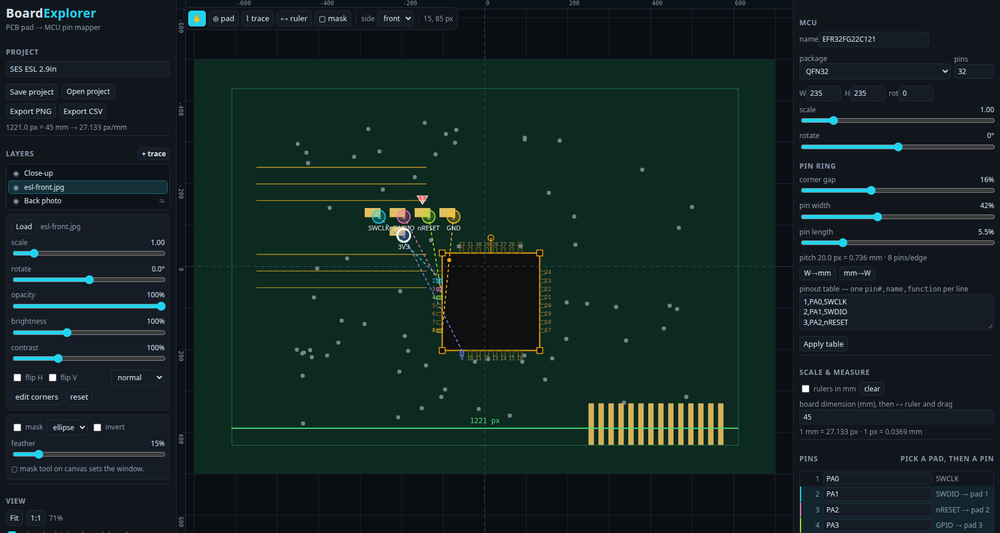

<div align="center">

# BoardExplorer

**Which MCU pin is that pad on?**

A single-file, offline web tool for reverse-engineering the pad → MCU pin mapping
of a board you don't have schematics for.

Import photos of both sides, align them as a mirror, overlay the MCU package,
and build a mapping table you can export.

[](#quick-start)
[](#how-it-works)
[](#how-it-works)
[](#how-it-works)



</div>

---

## The problem

You have a board in front of you and a multimeter. Somewhere on it is a QFN
with 32 pads and no silkscreen legend. There are five test pads near the chip
that look like an SWD cluster, but which pins are they?

The usual answer is a datasheet, a pinout diagram, a photo, and a lot of
squinting while you count diagonally across a package. It is slow, it is
error-prone, and the numbers don't survive to the next session.

BoardExplorer turns that into a visual, repeatable exercise: put the photo on
the canvas, put the *package outline* on the photo, and link the pads you can
see to the pins you know.

<table>
<tr><td width="50%" valign="top">

**Without it**
- Count pins around a package in a blurry photo
- Guess whether pad 4 is PA3 or PA4
- Lose the work when you close the tab
- Re-derive the mapping next month

</td><td width="50%" valign="top">

**With it**
- Package outline sits *on* the chip, pin numbers where they belong
- Click a pad, click a pin — the link is recorded and drawn
- Project autosaves, and exports to JSON + CSV
- The mapping is a document you can hand to someone

</td></tr>
</table>

## Quick start

```bash
git clone https://github.com/brnomt/BoardExplorer.git
cd BoardExplorer
open index.html          # or: python3 -m http.server 8080
```

That's it. No install, no build, no node_modules, no server. Chrome, Firefox
or Safari. It also works from a `file://` URL, fully offline.

## How it works

<details>
<summary><b>The 30-second version</b></summary>

<br>

1. Load the **front** photo.
2. Load the **back** photo, keep *mirror back* on, and set the blend to
   **difference**. Nudge scale/rotate/position until the vias cancel out — that
   proves both shots are the same board at the same scale.
3. Drag the **MCU outline** onto the chip. Set the pin count, then dial in
   *corner gap*, *pin width* and *pin length* until the drawn pins sit on the
   real ones. The **pitch** readout confirms it against the datasheet.
4. Click **⊕ pad** on each exposed test pad, name it.
5. Click the pad, then click the MCU pin it rings out to.
6. **Export**.

</details>

<details>
<summary><b>Why mirror the back photo?</b></summary>

<br>

The back of a board is a mirror of the front when you look through it. Photograph
it, and every feature is flipped. If you align the raw back photo to the front
one you'll only ever match things that happen to be symmetric.

With *mirror back* on, the back image is flipped horizontally before layout, so
through-vias and shared mounting holes line up with the front. Then the
**difference** blend makes identical features go black, and anything that
disagrees lights up. That's your alignment signal.

</details>

<details>
<summary><b>Any image format, including RAW</b></summary>

<br>

PNG, JPEG, WebP, AVIF, GIF and BMP decode natively. Camera RAW
(DNG, CR2, CR3, NEF, ARW, ORF, RAF, RW2, SRW, PEF, 3FR, ERF, KDC, MRW, X3F),
plus TIFF and HEIC, aren't decodable by a browser canvas — so BoardExplorer
scans the file for the **embedded JPEG preview** most cameras write, and decodes
that. Full resolution in practice, and it means you can drag a `.DNG` straight
in without a conversion step.

Decoded images are normalised to PNG and re-encoded, which bakes in EXIF
orientation so the project file is portable between machines.

If a RAW has no embedded preview, you get a clear message rather than a blank
canvas. That's rare, but it happens with some phone RAW modes.

</details>

<details>
<summary><b>Perspective correction</b></summary>

<br>

A phone photo of a board is never perfectly square-on. If the shot was taken
from below, the chip is a trapezoid, and a rectangle laid over it will never
match all four edges.

Hit **edit corners** on a layer and drag its four corners onto the real board
corners. The photo is resampled through an inverse homography, so the package
becomes a rectangle and your overlays line up. It's the same math as a
document-scanner app.

The warp is computed on the CPU and cached per quad, capped at 1600px on the
long side while you drag. On a 24MP photo you'll feel it. The cached result is
what gets drawn, so the tool stays responsive.

</details>

<details>
<summary><b>Calibration, and why pitch is the number that matters</b></summary>

<br>

Drop a line across a dimension you know — the board edge, a connector, the
silkscreen — and type the real length in mm. From then on rulers, coordinates
and measurements read in mm.

That unlocks the useful part: the **pin pitch readout**. A QFN32 with 0.5mm
pitch has pins 0.5mm apart. Set the package size, adjust the corner gap until
the drawn pins sit on the photographed ones, and the readout tells you whether
you're at 0.5mm or not. If it says 0.736mm, either your package size is wrong
or you're not looking at a 0.5mm part.

You can also convert the other way: type a datasheet width in mm and the
outline resizes to match.

</details>

<details>
<summary><b>Masks and overlays</b></summary>

<br>

Sometimes the wide shot has the context and a close-up has the detail. A
**mask** window (ellipse or rect, with feather and invert) lets a close-up
layer show through only over the chip, while the wide shot provides everything
around it.

Combined with per-photo **brightness and contrast**, this covers the shot that
came out dark, or the one where the copper is washed out by the light.

</details>

## Copper traces

The dashed line from pad to pin is a **hypothesis**: "I believe these are
connected." A **trace** is the evidence: the actual path the copper takes,
drawn waypoint by waypoint over the photo.

Both exist because they answer different questions. The link is what you
assert; the trace is what you saw.

Traces live in the layer stack like anything else in Photoshop — name, colour,
width, front or back side, and an eye to hide them. You can draw several and
toggle them independently.

```
⌇ trace  → click to add waypoints, Enter to finish, drag a dot to move it
```

## Keyboard

| Key | Action |
|---|---|
| `Z` | zoom in on the selection (or fit, if already zoomed) |
| `R` / `Shift`+`R` | rotate the active layer ±1° |
| `←↑↓→` | nudge the selected pad (`Shift` = ×10) |
| `Del` | delete the selected pad |
| `F` | fit everything in view |
| `Esc` | deselect / leave perspective edit |
| `Enter` | finish the current trace |
| `Alt`+drag | move the active layer |
| wheel | zoom at the cursor |

## Exports

| File | What's in it |
|---|---|
| `<project>.board.json` | Everything: photos (base64), every transform, pads, links, traces, MCU model, calibration |
| `<project>-overlay.png` | The canvas at 2×, photo + pads + links + traces, no UI chrome |
| `<project>-pads.csv` | The mapping table: pad, side, label, notes, pin, pin name, function, continuity |

The project file round-trips. Open it on another machine and you get the same
board back, photos included. Sessions also autosave to `localStorage`; if two
big photos blow the quota, it tells you and drops the images rather than
failing silently.

## What it is not

- **No automatic pad detection.** No computer vision in v1. You click the pads.
  Automatic detection on unknown, variably-lit PCBs is a research problem, and
  a wrong guess is worse than no guess when you're about to probe a live board.
- **No multimeter integration.** It records what *you* measured. The continuity
  column is your notes, not a reading.
- **No firmware work.** It maps pins, it doesn't flash anything.

## Design notes

A few decisions worth explaining, because they look like omissions:

**One file, no build.** A `npm create vite` project is four hundred lines of
scaffolding around two hundred lines of code, and it needs a toolchain to open
a photo. `index.html` is the whole app. You can email it, and it works.

**Canvas, not SVG.** The perspective warp needs per-pixel sampling, and the
mask needs a compositing pass. Both are canvas-native. SVG would mean
`<foreignObject>` tricks and a worse time.

**Coordinates are world-space.** Pads, traces and the MCU outline live in a
scale-independent coordinate system, so zooming never moves your annotations.
The trade-off: if you later `Alt`+drag the photo, the annotations stay put.
That's right for documenting, wrong for re-framing — so re-frame *after*
annotating, or annotate once the photo is where you want it.

**Pins are fractions, not pixels.** Pin width is a fraction of the pin pitch,
pin length a fraction of the package size. An early version used fixed pixel
sizes, which meant a small chip at high zoom got comically fat pins. Geometries
should scale with the thing they describe.

## Status

Works, tested, and used on a real SES-imagotag ESL with an EFR32FG22 QFN and an
NT3H2111 NFC frontend. There's a self-check built in:

```
index.html?selftest
```

It logs pass/fail to the console for the pin layout, homography round-trip,
calibration math, and layer transforms. Not a replacement for the click-through
tests, but it catches a broken transform immediately.

## License

MIT

---

<div align="center">

*Built for the moment you're holding a probe and wondering which of five
identical pads is SWCLK.*

</div>

## 💛 Support

[](https://ko-fi.com/brnomt)
